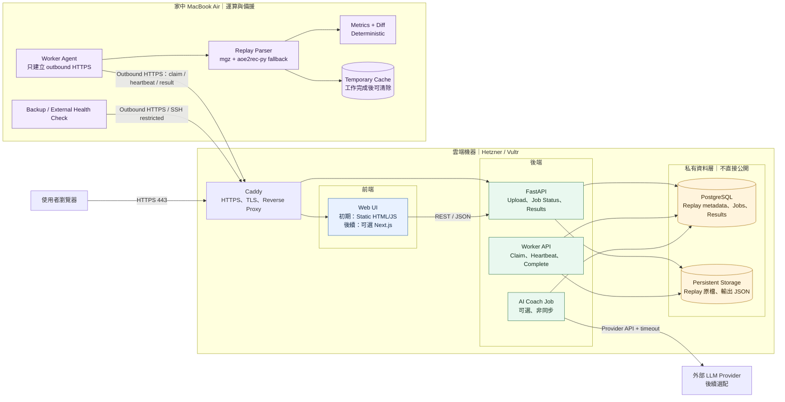
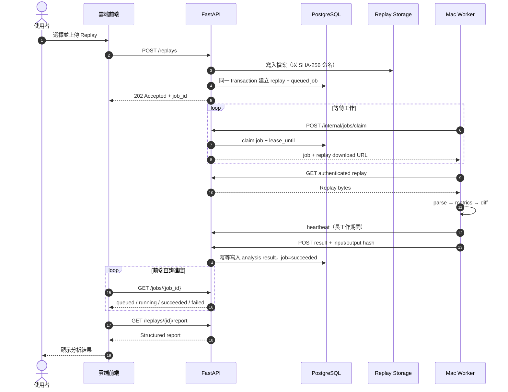
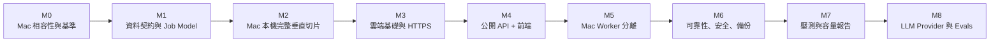

# Hybrid Cloud Architecture：雲端服務 + Mac Worker

更新日期：2026-10-25

## 目標與範圍

這份文件定義 AoE2 Replay Coach 從目前 CLI 走向可公開使用的 Web 服務時，前端、雲端機器與閒置 MacBook Air 的責任邊界和實作順序。

第一版選擇低成本、可搬移的架構：

- 雲端是公開入口及唯一資料真相來源（source of truth）。
- Mac 負責 CPU 密集的 Replay parsing，離線時只讓工作排隊。
- PostgreSQL 同時保存業務資料及 job queue，不先加入 Redis、RabbitMQ 或 Kafka。
- Replay 初期存放於雲端主機的持久化磁碟；容量或備援需求出現後才搬 Object Storage。
- 前端第一版延續靜態 HTML/JavaScript；API 穩定後再決定是否需要 Next.js。
- LLM 是最後一層非同步解釋，不介入 deterministic parsing、metrics 或 diff。

## 服務架構圖



### 元件責任

| 位置 | 元件 | 責任 | 不負責 |
|---|---|---|---|
| 使用者端 | Browser | 上傳 Replay、查看進度與報告 | 不直接連 PostgreSQL 或 Mac |
| 雲端前端 | Web UI | 畫面、表單、poll job status、呈現結果 | 不解析 Replay、不保存 secret |
| 雲端入口 | Caddy | HTTPS、TLS、reverse proxy、靜態檔案 | 不包含業務規則 |
| 雲端後端 | FastAPI | 驗證輸入、建立 job、查詢結果、授權 | 不在 request 內執行 parser 或 LLM |
| 雲端資料層 | PostgreSQL | metadata、job state、metrics、diff、AI run | 不直接公開到 Internet |
| 雲端檔案 | Persistent Storage | Replay 原檔與大型 JSON | 不作為唯一備份 |
| Mac | Worker Agent | 主動領取工作、heartbeat、回傳結果 | 不接受 Internet inbound connection |
| Mac | Parser/Analyzer | parsing、metrics、diff | 不成為 source of truth |
| 外部服務 | LLM Provider | 根據 evidence 產生文字解釋 | 不計算 deterministic metrics |

## 一場 Replay 的資料流



### 故障時的預期行為

- Mac 睡眠或斷線：job lease 到期後回到可領取狀態，不遺失工作。
- 同一 Replay 重複上傳：以 SHA-256 與 analysis version 去重。
- 同一 job 執行兩次：結果寫入使用唯一鍵及 idempotency key，只保留一份邏輯結果。
- 雲端重啟：PostgreSQL 保存 job state，Caddy、API、DB 及服務由 systemd 或 Docker restart policy 恢復。
- Parser partial/failed：保存狀態、parser metadata、錯誤與可用部分，不偽裝成功。
- Mac 永久不可用：可在雲端臨時啟動同一份 worker image，不改資料格式。

## 網路與安全邊界

```text
Internet 可存取
  80/tcp   Caddy redirect to HTTPS
  443/tcp  Frontend + Public API + authenticated Worker API

限制來源
  22/tcp   SSH，只允許管理者 IP 或 VPN

禁止公開
  5432     PostgreSQL
  Docker socket
  Mac remote login / screen sharing
  Monitoring admin endpoints
```

必要控制：

- Browser 與 Mac worker 使用不同身份及權限。
- Worker token 放在 Mac secret store 或權限受限的環境檔，不提交 Git。
- Worker API 加入短效 token 或可輪替 token；後續可升級成 mTLS/VPN。
- Replay 下載 URL 必須驗證 worker 身份並限制有效時間。
- 上傳限制副檔名、大小與 request timeout；Replay 一律視為不可信輸入。
- PostgreSQL 只綁定 Docker/private network。
- 備份加密，且備份身份不能刪除正式資料。
- 日誌不得記錄 replay 原始內容、authorization header 或 provider secret。

## 實作路徑



原則是先在 Mac 上完成單機垂直切片，再搬到雲端，最後才切出 hybrid worker。這樣每次只增加一種複雜度，也保留可回退的已知正常版本。

## Milestone 計畫

預估以每週 8～10 小時投入，核心 hybrid 版本約 10～12 週；M8 為後續選配。

### M0：Mac 可用性與 Parser 基準（第 1 週）

工作：

- 記錄 Mac 型號、CPU 架構、RAM、磁碟、macOS 與網路。
- 以 lockfile 安裝專案並執行完整 `make check`。
- 驗證 `mgz` 與 `aoe2rec-py` 在 arm64/x86_64 的可用性。
- 以固定 corpus 測量單 worker 的解析時間、CPU、峰值 RAM。
- 設定測試期間不睡眠，確認長時間滿載是否 thermal throttling。

退出條件：

- 所有自動測試通過。
- 至少三份真實 Replay 可解析，限制有紀錄。
- 產出第一份 Mac parser baseline。

### M1：資料契約、PostgreSQL 與 Job 狀態機（第 2～3 週）

工作：

- 建立 migration 與 `replays`、`analysis_runs`、`jobs`、`results`。
- 定義 job 狀態：`queued → running → succeeded | failed`。
- 加入 `attempts`、`available_at`、`lease_until`、`last_error`。
- 定義 dedupe key：`replay_sha256 + parser_version + ruleset_version`。
- 為 claim、status、result query 建立索引並保存 query plan。

退出條件：

- 空資料庫可由 migration 建立。
- 同一 Replay 上傳十次只建立一份邏輯 analysis。
- worker crash 後 lease 能被重新領取。

### M2：Mac 本機完整垂直切片（第 4 週）

工作：

- 建立本機 Docker Compose：Caddy、FastAPI、PostgreSQL、worker。
- 實作 `POST /replays`、`GET /jobs/{id}`、`GET /replays/{id}/report`。
- Replay upload 不同步解析，立即回 `202 Accepted`。
- Worker 從 job table 領取、解析並寫回結果。
- 先使用現有 static demo 擴充 upload/status/result，不引入 Next.js。

退出條件：

- 從瀏覽器上傳一場 Replay，到看到 report 全流程成功。
- 關閉 worker 不影響 API；工作保留 queued。
- 重啟全部 container 後資料仍存在。

### M3：雲端基礎環境（第 5 週）

工作：

- 建立 Hetzner/Vultr 2 vCPU、4 GB VM。
- 設定非 root 管理帳號、SSH key、firewall、automatic security updates。
- 設定 DNS、Caddy 與 HTTPS。
- 以 Docker Compose 部署同一套 image，但先不連家中 Mac。
- 建立部署腳本及 `.env.example`，secret 不進 Git。

退出條件：

- 公網只能存取 80/443，SSH 受到限制，5432 無法從 Internet 連線。
- `/health` 與 `/ready` 可正確區分 process alive 和 dependency ready。
- 從空 VM 可依文件重建環境。

### M4：公開 API 與前端（第 6 週）

工作：

- 將 upload/job/report API 部署雲端。
- 加入檔案大小、格式、rate limit 與 request ID。
- 前端支援上傳、狀態 polling、失敗顯示、報告呈現。
- 建立 replay retention 規則及磁碟容量告警。

退出條件：

- 台灣網路可透過 HTTPS 完成上傳與查詢。
- API response 不等待 parser。
- partial/failed 結果在 UI 有明確警告。

### M5：Mac Worker 分離（第 7～8 週）

工作：

- 實作 authenticated Worker API：claim、heartbeat、complete、fail。
- Mac 只使用 outbound HTTPS，不開 inbound port。
- Replay 使用受權限保護的下載路徑；結果附帶 input/output hash。
- 設定 worker service 自動啟動與 crash restart。
- 工作完成後依 retention policy 清理 Mac temporary cache。

退出條件：

- Mac 開機時自動處理 queued jobs。
- Mac 離線時 API 正常，job 持續排隊。
- 強制終止 worker 後 job 可恢復，不產生重複 analysis。
- 相同 worker image 可臨時在雲端執行。

### M6：可靠性、安全與備份（第 9 週）

工作：

- PostgreSQL 每日 `pg_dump`，Replay/manifest 增量備份到 Mac。
- 再保留一份加密異地備份；預算允許時使用 Object Storage。
- 加入 structured logs、request/job correlation ID。
- 監控 API latency/error、queue depth/oldest age、disk、DB connections。
- 演練 token rotation、worker crash、雲端 reboot、磁碟接近滿載。

退出條件：

- 能在全新資料庫成功 restore 並通過資料驗證。
- 告警可在 queue 停滯與磁碟不足時觸發。
- runbook 記錄故障診斷與恢復步驟。

### M7：k6、單機容量與 Hybrid 瓶頸（第 10～12 週）

工作：

- k6 不在被測雲端 VM 上執行。
- 分別測 read API、upload/job creation、Mac parsing、mixed workload。
- 記錄 p50/p95/p99、error rate、queue age、CPU、RAM、disk、DB pool。
- 比較 Mac worker、雲端 shared CPU 及短租 dedicated CPU。
- 定義最大穩定容量：持續滿足 SLO 且 backlog 不成長的最高負載。

退出條件：

- 壓測腳本、資料集、硬體與版本可重現。
- 報告分清楚 Internet latency、API latency、queue wait、parse duration。
- 能指出第一個飽和資源及下一個最值得做的優化。

### M8：LLM Provider 與 AI Evals（核心 hybrid 完成後）

工作：

- 接入 structured-output provider，不改 deterministic pipeline。
- AI job 非同步執行並設 timeout、rate limit、cost budget、fallback。
- 每項 observation 引用 evidence ID。
- 建立 golden dataset，比較 prompt/model 版本。

退出條件：

- Provider 無法使用時仍可回傳 rule-based report。
- 更換 prompt/model 前後有 groundedness、correctness、latency、cost 比較。
- 歷史結果可依 parser/ruleset/prompt/model version 判斷是否重算。

## 第一版 API 契約

### Public API

```text
POST /replays
GET  /jobs/{job_id}
GET  /replays/{replay_id}
GET  /replays/{replay_id}/report
GET  /health
GET  /ready
```

### Worker API

```text
POST /internal/jobs/claim
POST /internal/jobs/{job_id}/heartbeat
GET  /internal/replays/{replay_id}/download
POST /internal/jobs/{job_id}/complete
POST /internal/jobs/{job_id}/fail
```

Worker API 不等同一般使用者 API；它需要獨立身份、較窄權限、request size limit、audit log 與 token rotation。

## 第一版部署目錄目標

```text
deploy/
  compose.yml
  compose.worker.yml
  Caddyfile
  .env.example
  cloud-init.yml

backend/
  src/aoe2coach/
    api/
    jobs/
    storage/
    worker/

frontend/
  static/                 # 第一版；確認需求後再決定 Next.js

loadtest/
  smoke.js
  read.js
  upload.js
  mixed.js

docs/
  adr/
  benchmarks/
  runbooks/
```

## 暫緩項目與啟用條件

| 暫緩項目 | 何時才加入 |
|---|---|
| Managed PostgreSQL | DB 維護或可用性要求超過單機能承擔時 |
| Object Storage | Replay 容量、備份或多 worker 共用檔案成為問題時 |
| Redis/RabbitMQ/Kafka | PostgreSQL queue 經實測成為瓶頸或缺少必要語意時 |
| Load Balancer | 一台 API 無法滿足 SLO，需要至少兩台 API 時 |
| Kubernetes | 服務、團隊與部署頻率足以抵銷平台複雜度時 |
| Next.js | 靜態前端無法滿足 routing、SSR 或前端工程需求時 |
| 完整 tracing stack | logs + metrics 無法在合理時間定位跨服務問題時 |

## Hybrid V1 Definition of Done

- 使用者能從公開 HTTPS 前端上傳 Replay 並取得 job ID。
- 雲端 API 不同步執行 parser；Mac 離線不影響 API 可用性。
- Mac 不開公開 inbound port，能安全領取工作並回傳結果。
- job 至少具備 lease、retry、idempotency 與明確失敗狀態。
- PostgreSQL、Replay 和分析結果有可驗證的備份與 restore 流程。
- parser、ruleset、input hash 與 result hash 可追溯。
- 能用 k6 與 parser benchmark 說明雲端、網路、Mac 各自的容量與瓶頸。
- 同一套 worker image 可以在 Mac 或雲端執行，避免被單一硬體綁死。
